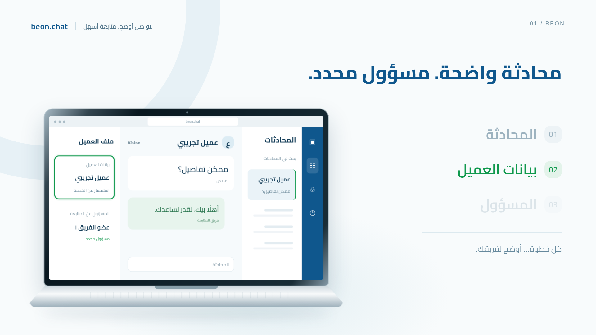
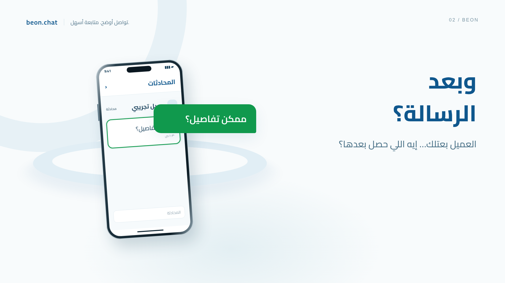
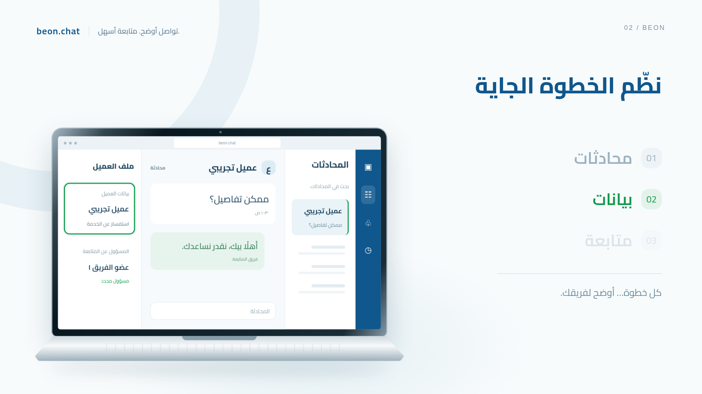
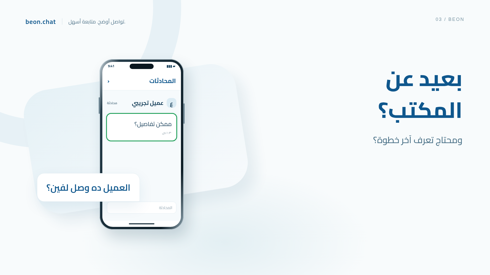
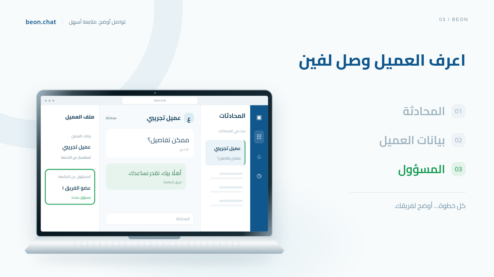

# حملة BeOn — ثلاثة إعلانات منتج

مشروع Remotion قابل للتعديل، بثلاث قصص مستقلة وهوية موحّدة. كل إعلان **٢٠ ثانية بالضبط**: 1920×1080، و30fps، و600 إطار. آخر ٣ ثوانٍ ثابتة بصريًا.

[تنزيل المشروع واللقطات ZIP](review/beon-project.zip?raw=true) · [ملاحظات الأصول والتشغيل](README.txt) · [فحص المدة](review/verification.json) · [اختبار التشغيل الكامل](review/playback-check.json)

## حالة النسخة

نسخة مراجعة بواجهات توضيحية وبيانات تجريبية؛ تحتاج اللوجو وواجهات المنتج الأصلية قبل النشر. المراجع الثلاثة المذكورة في الطلب لم تكن متاحة ضمن الملفات. الموسيقى والمؤثرات الأصلية مرفقة فعلًا، والتعليق المصري لم يُنتج بعد. النصوص الحرفية موجودة في [voiceover.json](scripts/voiceover.json).

## ملفات MP4 المصدّرة

1. [مين تابع العميل؟ — MP4](exports/BeOn_Ownership_20s.mp4?raw=true)
2. [الرسالة بداية — MP4](exports/BeOn_AfterMessage_20s.mp4?raw=true)
3. [بعيد عن المكتب؟ — MP4](exports/BeOn_Anywhere_20s.mp4?raw=true)

كل ملف H.264، بدقة 1920×1080، ومعدل 30fps، ومدة 20 ثانية، مع موسيقى ومؤثرات AAC. الواجهات مؤقتة ولا يوجد تعليق صوتي مصري. [فحص الملفات المصدّرة](exports/verification.json).

لإعادة التصدير بعد تعديل المشروع:

```sh
node scripts/export.mjs
```

يلزم وجود FFmpeg في PATH لضبط نهاية مسار الصوت إلى ٢٠ ثانية بدقة. يمكن تعيين متغير CHROME_PATH لمسار Chromium على جهازك.

## تشغيل المعاينة

```sh
npm ci
npm run dev
```

افتح رابط Remotion Studio الذي يظهر في الطرفية. اختر أحد الإعلانات الثلاثة من الشريط الجانبي. لا تحتاج المعاينة إلى تحميل أصول خارجية.

```sh
npm run lint
npm run review
```

أمر المراجعة يستخرج صور PNG، ولا يصدّر الفيديو. يستخدم `/usr/bin/chromium`؛ عدّل `browserExecutable` في `scripts/review.mjs` إذا اختلف مساره على جهازك.

| الاسم المطلوب | Composition داخل Studio |
| --- | --- |
| BeOn_Ownership_20s | BeOn-Ownership-20s |
| BeOn_AfterMessage_20s | BeOn-AfterMessage-20s |
| BeOn_Anywhere_20s | BeOn-Anywhere-20s |

Remotion لا يسمح بالشرطة السفلية داخل Composition id، لذلك استُخدمت الشرطة العادية.

## لقطات المراجعة

### مين تابع العميل؟

| البداية | المنتج | القفلة |
| --- | --- | --- |
| [](review/BeOn-Ownership-20s-opening.png) | [](review/BeOn-Ownership-20s-product.png) | [](review/BeOn-Ownership-20s-closing.png) |

### الرسالة بداية

| البداية | المنتج | القفلة |
| --- | --- | --- |
| [](review/BeOn-AfterMessage-20s-opening.png) | [](review/BeOn-AfterMessage-20s-product.png) | [](review/BeOn-AfterMessage-20s-closing.png) |

### بعيد عن المكتب؟

| البداية | المنتج | القفلة |
| --- | --- | --- |
| [](review/BeOn-Anywhere-20s-opening.png) | [](review/BeOn-Anywhere-20s-product.png) | [](review/BeOn-Anywhere-20s-closing.png) |

## التعديل والأصول

- `src/Root.tsx`: الإعلانات الثلاثة والمشاهد وتوقيتها.
- `src/scenes/`: مشاهد مستقلة قابلة للتحرير داخل Studio.
- `src/components/`: الأجهزة والواجهات وعناصر المشاهد المشتركة.
- `src/brand.ts`: مسارات اللوجو ولقطات المتصفح والموبايل الأصلية عند توفيرها.
- `public/`: الخط والشارتان والصوت المحلي.

تفاصيل النواقص وحدود المشاهد ومصادر الأصول في [README.txt](README.txt). لا تعرض النسخة الحالية مزامنة لحظية أو خصائص متطابقة بين الأجهزة، ولا إنشاء موعد متابعة غير مثبت بالأصول.
