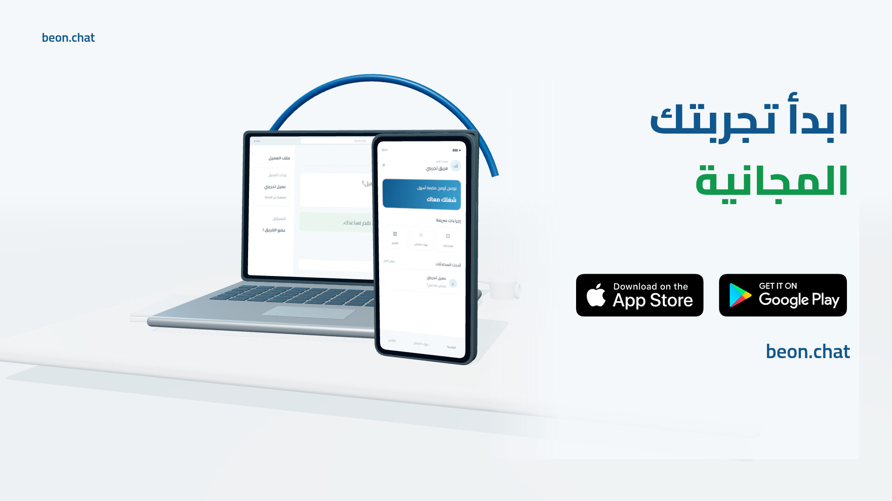

# BeOn — إعلان بيعي ثلاثي الأبعاد، ٢٥ ثانية

[تحميل فيديو MP4](exports/BeOn_Sales_25s.mp4?raw=true) · [تنزيل المشروع واللقطات ZIP](review/beon-sales-25s-project.zip?raw=true) · [فحص الملف المصدّر](exports/verification.json)

[](exports/BeOn_Sales_25s.mp4?raw=true)

نسخة مراجعة مبنية على المراجع الأربعة: أجهزة ومكتب وبطاقات ثلاثية الأبعاد فعلية، مع كاميرا مرتبطة بالإطارات وانتقالات بين خمس مشاهد. **1920×1080، و30fps، و750 إطارًا، ومدة ٢٥ ثانية بالضبط.**

الشاشات الحالية توضيحية مؤقتة، ولم يُدرج ملف اللوجو الأصلي؛ الصور ظهرت داخل المحادثة دون ملفات قابلة للتنزيل في بيئة التنفيذ. لا توجد بيانات عملاء حقيقية. الموسيقى والمؤثرات الأصلية موجودة، والتعليق المصري لم يُنتج بعد.

## تشغيل المشروع

```sh
npm ci
npm run dev
```

اختر `BeOn-Sales-25s` داخل Remotion Studio. الاسم المقابل في الوصف هو `BeOn_Sales_25s`؛ Remotion لا يقبل الشرطة السفلية داخل Composition id.

```sh
npm run lint
npm run review
npm run export
python scripts/verify-export.py
```

يستخدم التصدير Chromium مع WebGL2/Swangle. عيّن `CHROME_PATH` عند اختلاف مسار Chromium عن `/usr/bin/chromium`. يلزم وجود FFmpeg في `PATH` لضبط نهاية الصوت إلى ٢٥ ثانية دون تغيير السرعة. المعاينة تعمل أفضل على جهاز يدعم GPU.

## المشاهد الخمسة

| المشهد | الزمن | لقطة مراجعة |
| --- | --- | --- |
| الفرصة وصلت | ٠–٥ | [مشاهدة](review/01-problem.png) |
| المحادثات في مكان واحد | ٥–٩ | [مشاهدة](review/02-gather.png) |
| المتابعة أوضح | ٩–١٣ | [مشاهدة](review/03-followup.png) |
| شغلك معاك | ١٣–١٩ | [مشاهدة](review/04-mobile.png) |
| ابدأ تجربتك المجانية | ١٩–٢٥ | [مشاهدة](review/05-closing.png) |

الكاميرا والعناصر ثابتة خلال آخر ٣ ثوانٍ. [فحص ثبات القفلة](review/closing-stability.json) · [اختبار تشغيل المعاينة](review/playback-check.json).

## تعديل الأصول

- `src/World.tsx`: البيئة والأجهزة والإضاءة والكاميرا.
- `src/scenes/`: نصوص المشاهد وتوضيحات المتابعة.
- `src/Root.tsx`: خط الزمن والتسجيلات.
- `src/config.ts`: مسارات الأصول والنص الصوتي المعتمد.
- `narration.txt`: النص الصوتي دون تعديل؛ لم يُنتج تسجيله بعد.

بطاقات المسؤول والموعد توضيح مفاهيمي خارج واجهة المنتج، وليست تسجيلًا لاختيار مسؤول أو حفظ موعد. لا تفترض النسخة مزامنة لحظية أو خصائص متطابقة على الأجهزة. يحتاج اعتماد المشاهد الفعلية صورًا/تسجيلًا للخطوات الأصلية، مع تغطية أي بيانات شخصية.

تفاصيل المراجع ومصادر الأصول والترخيص والنواقص في [README.txt](README.txt) و[asset-manifest.json](asset-manifest.json).
